

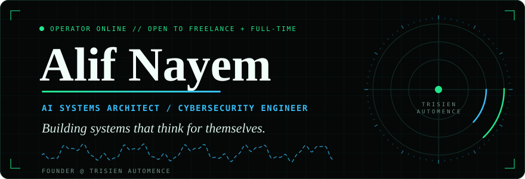


 

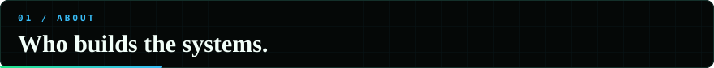

I am an AI systems architect and cybersecurity engineer. I direct prompt-engineered builds from architecture through production deployment. I founded **Trisien Automence** to design self-hosted multi-agent infrastructure with zero recurring SaaS cost and full data ownership. Applied security is my active self-directed specialization.

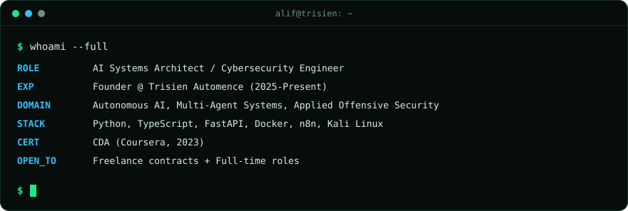

*Two boots, one operator. Left is what I build with. Right is what I'm building toward.*

<table>
<tr>
<td width="50%">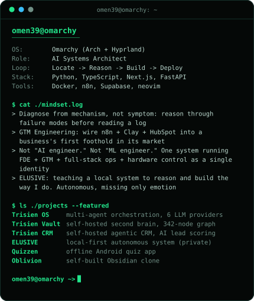</td>
<td width="50%">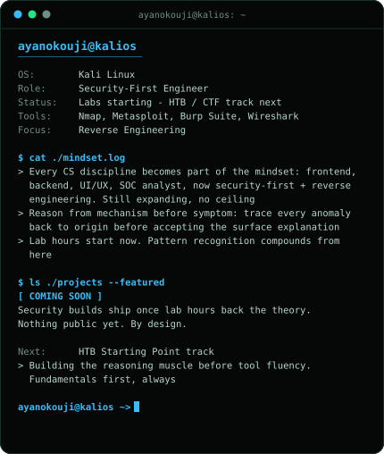</td>
</tr>
</table>

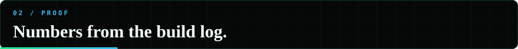

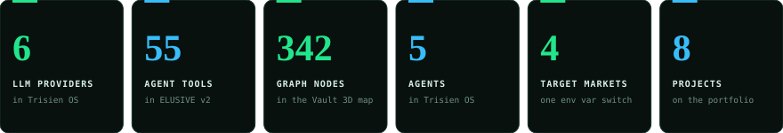

<!--
  SECURITY PROOF GOES HERE.
  Your title says Cybersecurity Engineer but no section shows it yet.
  Add one row once you have it: a CTF result, a lab writeup, a tool you built or a cert.
  Link each item. Do not publish this section empty.
-->

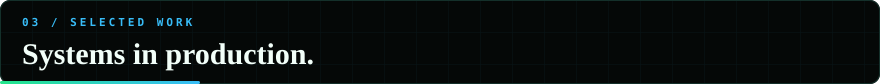

<table>
<tr>
<td width="50%"><a href="https://trisien-os-accounting.vercel.app">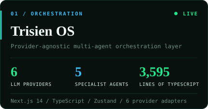</a></td>
<td width="50%"><a href="https://trisien-vault.vercel.app">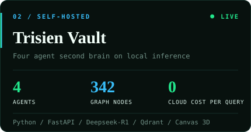</a></td>
</tr>
<tr>
<td width="50%"><a href="https://trisien-crm.vercel.app">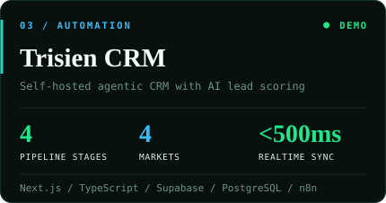</a></td>
<td width="50%"><a href="https://a-nayem.vercel.app/elusive">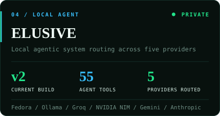</a></td>
</tr>
<tr>
<td width="50%"><a href="https://a-nayem.vercel.app">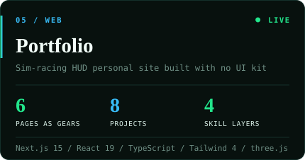</a></td>
<td width="50%"><a href="https://trisien-automence.vercel.app">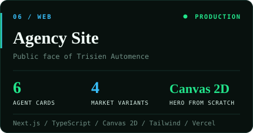</a></td>
</tr>
</table>

<strong>More projects</strong> - Web UI, LLM Lab, Multiagent-OS, Quizzen, Oblivion and NFC cards

 

**Trisien Web UI** - client dashboard (Spectre Flow)

| | |
|---|---|
| **Stack** | Next.js 16 App Router, TypeScript, Tailwind CSS v4 |
| **Scale** | 6 routes: agentic workflows, 3D rotating knowledge graph, run logs, CRM and leads, documents and settings |
| **Impact** | No external UI library with CSS-variable theming and dark mode through `prefers-color-scheme` |

[Live](https://trisien-web-ui.vercel.app) / [GitHub](https://github.com/a-nayem/trisien_web-ui)

**LLM Lab** - evals-first LLM engineering practice

| | |
|---|---|
| **Scope** | Prompting and tool calling / embeddings and vector search / RAG with reranking / an agent with tools and memory |
| **Method** | Every change is measured by an eval harness with cost and latency logged from day one |

[llm-lab](https://github.com/a-nayem/llm-lab) / [ml-lab](https://github.com/a-nayem/ml-lab) / [python-core](https://github.com/a-nayem/python-core)

**Multiagent-OS (SecondBrain)** - client-side AI knowledge system

| | |
|---|---|
| **Stack** | Next.js, TypeScript, Three.js, Gemini 2.5 Flash / OpenRouter |
| **Scale** | 5 agent roles, 10 free-tier models unified, 1,645 lines of verified TypeScript |
| **Impact** | Fully client-side with zero backend and zero hosting cost |

[Demo](https://multi-agent-daily.vercel.app) / [GitHub](https://github.com/a-nayem/multi-agent-daily) / [CI](https://github.com/a-nayem/multi-agent-daily/actions/workflows/ci.yml)

**Quizzen** (formerly Mind-Forge) - offline Android quiz app

| | |
|---|---|
| **Stack** | Apache Cordova, JavaScript, Android, LocalStorage |
| **Scale** | 6 domains with 400 questions each across 4 difficulty tiers plus an XP and level system |
| **Impact** | Fully offline with a 30-minute daily lock to enforce intentional practice |

[GitHub](https://github.com/a-nayem/Mind-Forge)

**Oblivion** - self-built Obsidian clone

| | |
|---|---|
| **Stack** | Next.js, React |
| **Scale** | Markdown notes with a graph view for linked-note visualization |
| **Impact** | Live self-hosted web app with zero dependency on Obsidian |

[Live](https://oblivion-nu.vercel.app/login)

**NFC Cards** - three small web experiences delivered as physical cards

| | |
|---|---|
| **Stack** | Next.js, TypeScript, NFC, Vercel |
| **Scale** | Elusive: Story of Safety (24 feelings) / Sketch the Air Muse (mood and scene to drawing idea) / Mood Dice (a small positive action for the day) |
| **Impact** | Each one is tapped in from an NFC card so the experience lives outside the screen |

[Story of Safety](https://elusive-story-of-safety.vercel.app) / [Air Muse](https://sketch-the-air.vercel.app) / [Mood Dice](https://mood-dice-rouge.vercel.app)

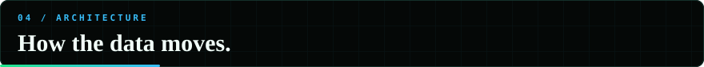

<strong>Trisien OS</strong> - One orchestrator with many providers and market behavior set by config.

 

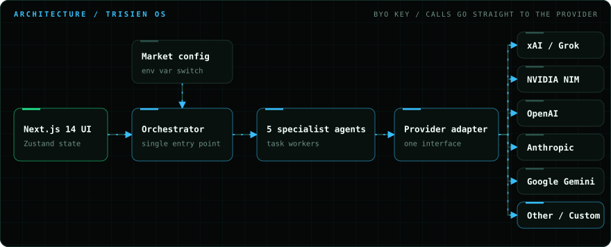

<strong>Trisien Vault</strong> - Self-hosted agents with local inference and vector memory.

 

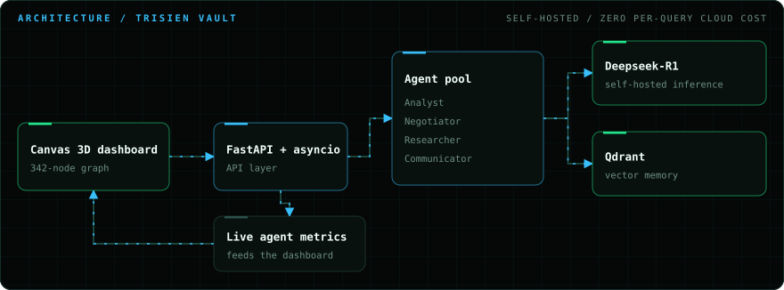

<strong>Trisien CRM</strong> - Lead scoring through n8n with realtime sync across Kanban and database.

 

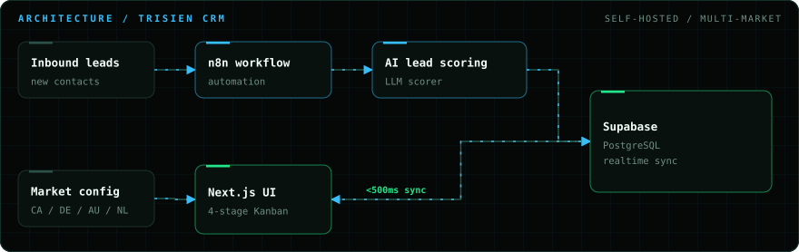

<strong>ELUSIVE</strong> - Local agent loop with a tool registry and multi-provider routing.

 

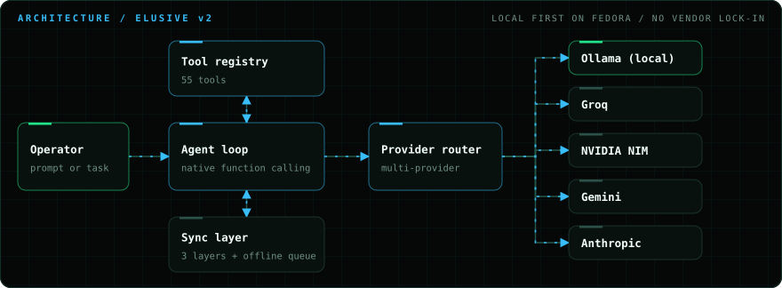

<strong>Portfolio</strong> - Next.js app with a three.js reactor scene and a scripted terminal.

 

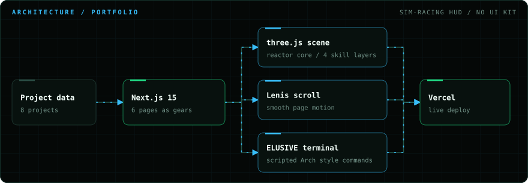

<strong>Agency Site</strong> - Market-specific copy around a Canvas 2D orbital hero.

 

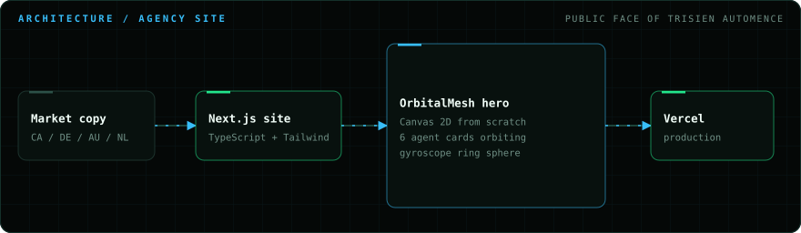

<strong>Multiagent-OS</strong> - Client-side agent roles routed through a model gateway.

 

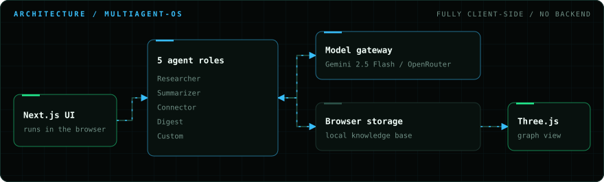

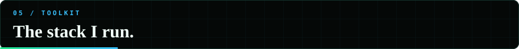

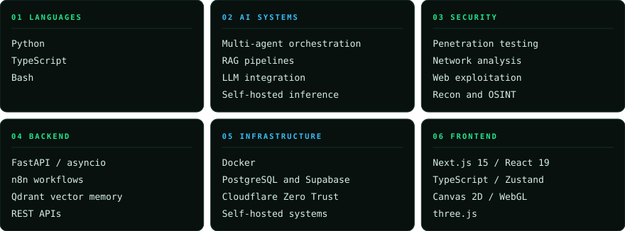

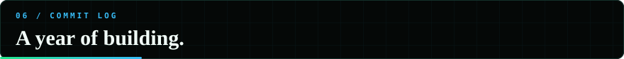

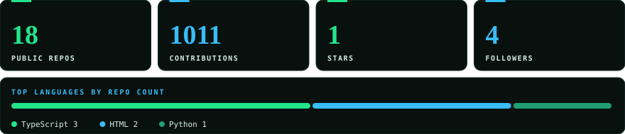

 


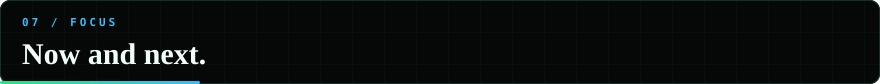

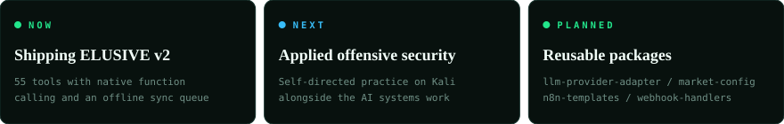

<strong>Planned packages</strong> - repeated logic being pulled out of the projects above

 

| Component | Source | Purpose | Status |
|---|---|---|---|
| `llm-provider-adapter` | Trisien OS | Single interface across OpenAI / Anthropic / Gemini / xAI / NIM | Planned |
| `market-config` | Trisien OS / CRM | Env-var market switch with zero duplicated logic | Planned |
| `n8n-templates` | Trisien CRM | Importable lead scoring and pipeline workflows | Planned |
| `webhook-handlers` | Trisien CRM | Validated event routing for automation pipelines | Planned |

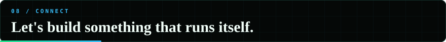

  

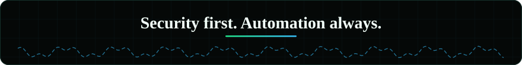

